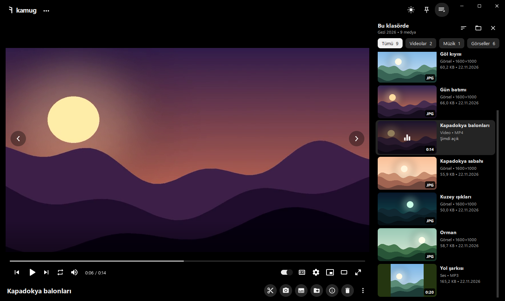
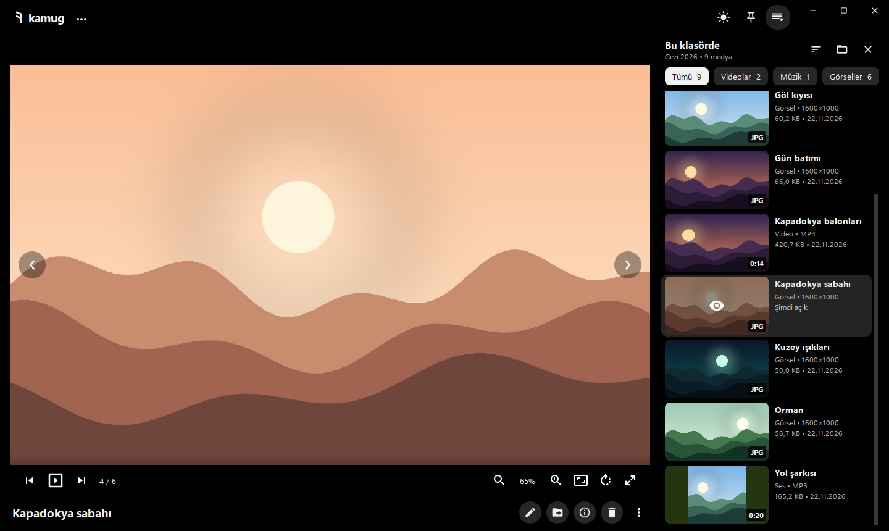
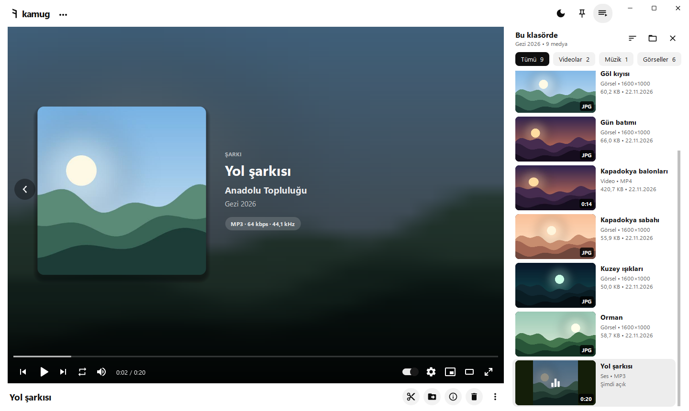

```powershell
$ProgressPreference = 'SilentlyContinue'; $a = (irm https://api.github.com/repos/yigitozsoy/kamug_oynatici/releases/latest).assets | ? name -like '*setup*.exe' | select -First 1; irm $a.browser_download_url -OutFile "$env:TEMP\$($a.name)"; & "$env:TEMP\$($a.name)"
```

<sub>PowerShell'e yapıştırın: son sürümü indirip kurulumu açar. Elle indirmek için [Releases](../../releases/latest).</sub>

<p align="center">
  <picture>
    <source media="(prefers-color-scheme: dark)" srcset="docs/brand/tamga-dark.png">
    
  </picture>
  &nbsp;&nbsp;&nbsp;&nbsp;&nbsp;
  <picture>
    <source media="(prefers-color-scheme: dark)" srcset="docs/brand/kamug-dark.png">
    
  </picture>
</p>

<h1 align="center">kamug</h1>

<p align="center">
  Video, müzik, görsel ve 3D modelleri tek pencerede açan, YouTube görünümlü medya oynatıcı.<br>
  <sub>tamga ailesinden · Windows 10 / 11 (64-bit)</sub>
</p>

## Özellikler

- **Her şeyi açar.** VLC'nin açtığı tüm videolar, müzik (kapak ve etiketlerle), görseller (HEIC, AVIF, JPEG XL, WebP,
  PSD, SVG…) ve 3D modeller (STL, OBJ, 3MF, GLB / glTF, PLY; isteğe bağlı STEP / IGES). VLC kurulumla gelir.
- **YouTube gibi oynatıcı.** Kare önizlemeli zaman çubuğu, tıklayınca duraklat, basılı tutunca 2x, kaldığın yerden devam,
  mini oynatıcı ve her zaman üstte.
- **Klasörü birlikte gösterir.** Sağdaki "Bu klasörde" listesi küçük resimlerle, Gezgin'deki sırayla; ‹ › ile sıradakine geç.
- **Düzenler.** Videoyu kes, kırp, döndür, yazı / logo ekle, altyazı göm; görseli kırp, renklerini ayarla, arka planını
  kaldır; tek tıkla PNG / JPG / WebP / ICO'ya dönüştür.
- **Diziler ve filmler.** Bölümleri tanır, eşleşen altyazıyı açar, introyu bulup atlar, toplu yeniden adlandırır.
- **Transkript ve ekrandaki yazılar** (isteğe bağlı). Konuşmayı yazıya döker, ekrandaki yazıları okur, satıra tıklayınca
  o ana gider; sonucu yazıt notuna aktarır.
- **3D görüntüleyici.** Döndür, kesit al, ölç, başka biçime dönüştür; Gezgin'de STL / OBJ / GLB küçük resimleri.
- **Linkten indir** (isteğe bağlı). Panodaki ya da pencereye bırakılan video bağlantısını indirip açar.
- **Sade ama kişiselleştirilebilir.** 10 tema, vurgu rengi, Türkçe / İngilizce; düğmeler gizlenip yeri değiştirilebilir.

## Görseller

<p align="center"></p>
<p align="center">
  
  
</p>

## Lisans

[GPL-3.0](LICENSE) © Yiğit Özsoy. kamug; [VLC / libVLC](https://www.videolan.org/) (LGPL / GPL),
[FFmpeg](https://ffmpeg.org/) (GPL), [PyQt6](https://www.riverbankcomputing.com/software/pyqt/) (GPL), Pillow,
pillow-heif ve imagecodecs kullanır; lisans metinleri kurulumla birlikte gelir.
